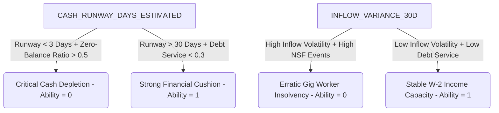

# Collection AI: Ability Feature Dictionary & Behavioral Mechanics

In an enterprise debt collection paradigm, **Ability** (Financial Capacity) is modeled separately from **Willingness** (Cooperativeness). 

* **Ability Model**: Predicts the liquid financial capacity of the customer to fulfill a given financial obligation.
* **Willingness Model**: Predicts the likelihood that a customer *intends* to resolve their arrears and is willing to engage in communication.

Separating these dimensions allows the **Matrix Engine** to classify customers into one of four strategic quadrants:
* **Q1 (Low Risk - Cooperative / Has Funds)**: Auto-recovers or resolves with light touch.
* **Q2 (Vulnerable - Cooperative / Lacks Funds)**: Requires restructuring, forbearance, or terms extension.
* **Q3 (Strategic Defaulter - Evasive / Has Funds)**: Requires intensive dunning, penalty threats, or early legal escalation.
* **Q4 (High Risk - Evasive / Lacks Funds)**: Early write-off candidate or immediate asset recovery.

---

## Technical Feature Dictionary & Behavioral Analysis

Below is the detailed breakdown of the features used in the Ability classifier (`TARGET_ABILITY`), explaining what each feature represents, how it is calculated, and its specific role in modeling transactional liquidity.

| Feature Name | Data Type | Concept Category | Predictive Role in Ability Modeling |
| :--- | :--- | :--- | :--- |
| **`CUST_INFO_ID`** | `pl.String` | Metadata | **Entity Identifier**: Uniquely identifies the customer. Excluded from training features to prevent leakage and overfitting. Used strictly as a key for left joins. |
| **`SNAPSHOT_DATE`** | `pl.String` | Temporal | **Temporal Anchor**: Defines the specific date when the features were calculated. Excluded from training, but critical for out-of-time (OOT) validation splits to verify model stability over time. |
| **`INFLOW_VARIANCE_30D`** | `pl.Float64` | Inflow Dynamics | **Income Volatility / Stability**: The statistical variance of deposits/inflows into the accounts over the last 30 days. **Low variance** indicates highly stable, predictable payroll income (high ability). **High variance** indicates unstable, erratic inflows (e.g. gig workers, contractors), which introduces cash flow uncertainty (moderate/low ability). |
| **`CASH_RUNWAY_DAYS_ESTIMATED`** | `pl.Float64` | Inflow Dynamics | **Liquidity Runway**: The number of days current liquid balances will last, based on the average monthly burn/expenditure rate. A runway of **>60 days** signals substantial liquid reserves to settle arrears (high ability). A runway of **<3 days** shows paycheck-to-paycheck survival, meaning any immediate lump-sum request is physically impossible (low ability). |
| **`SPENDING_VOLATILITY_CV_60D`** | `pl.Float64` | Outflow Dynamics | **Expenditure Volatility**: The Coefficient of Variation (CV) of outflows over the last 60 days. High spending volatility signals sudden large consumption spikes (medical shocks, debt contagion) that drain account liquidity, degrading ability. Low CV indicates extremely structured, disciplined budgeting. |
| **`DEBT_SERVICE_PROXY_RATIO`** | `pl.Float64` | Indebtedness | **Leverage Proxy (DSCR)**: The ratio of outstanding debt payments/fixed obligations relative to average monthly inflows. A high ratio **(>0.70)** means the customer's income is heavily leveraged by other bank loans, cards, or utilities, leaving virtually zero disposable income for arrears (low ability). |
| **`NSF_EVENT_RATE_60D`** | `pl.Float64` | Friction Indicators | **Non-Sufficient Funds (NSF) Rate**: The frequency of bounced checks or rejected direct debits due to empty balances in the last 60 days. **Direct behavioral proof of structural insolvency**. High NSF rates act as a heavy negative driver in capacity classification. |
| **`ZERO_BALANCE_DAYS_RATIO_30D`** | `pl.Float64` | Friction Indicators | **Account Depletion Ratio**: The percentage of days in the last month where the customer's ledger balance was exactly zero or negative. For example, a ratio of `0.50` means the customer spent 15 of the last 30 days completely broke, signaling severe chronic illiquidity (low ability). |
| **`TARGET_ABILITY`** | `pl.Int64` | Dependent | **Target Label**: The binary dependent variable (1 = Has Capacity; 0 = Insolvency/No Capacity). Behaviorally defined as a customer who successfully cleared their arrears or paid down at least their standard monthly installment within the outcome window. |

---

## Strategic Interaction Matrix (SHAP Driver Mechanics)

During machine learning training (using XGBoost or LightGBM), features do not act in isolation. The **Matrix Engine** leverages interaction weights to decipher true customer capacity:

### Key Behavioral Scenarios Interpreted by the Model

1. **Low Willingness / High Ability (Q3 - The Strategic Defaulter)**
   * *Feature Profile*: `DAYS_SINCE_LAST_RPC` (Willingness side) is very high (90+ days), but `CASH_RUNWAY_DAYS_ESTIMATED` is extremely healthy (45 days), `DEBT_SERVICE_PROXY_RATIO` is low (0.15), and `ZERO_BALANCE_DAYS_RATIO_30D` is 0.0.
   * *Interpretation*: The customer has plenty of money in their account (high ability) but is actively ignoring collectors. The model flags them as **Able** (`TARGET_ABILITY = 1`). Since they are evasive but financially stable, the system escalates directly to aggressive collection avenues (e.g. legal filings) because their account holds liquid reserves that can be targeted.

2. **High Willingness / Low Ability (Q2 - The Vulnerable Debtor)**
   * *Feature Profile*: The customer is highly responsive, but `ZERO_BALANCE_DAYS_RATIO_30D` is 0.60, `NSF_EVENT_RATE_60D` is high, and `CASH_RUNWAY_DAYS_ESTIMATED` is close to zero.
   * *Interpretation*: The customer wants to pay but has zero liquid money. Aggressive calling or legal threats will yield $0$ because the debtor has no funds to capture. The model classifies them as **Unable** (`TARGET_ABILITY = 0`). The recommendation is a long-term forbearance program, penalty waiving, or terms extension.
