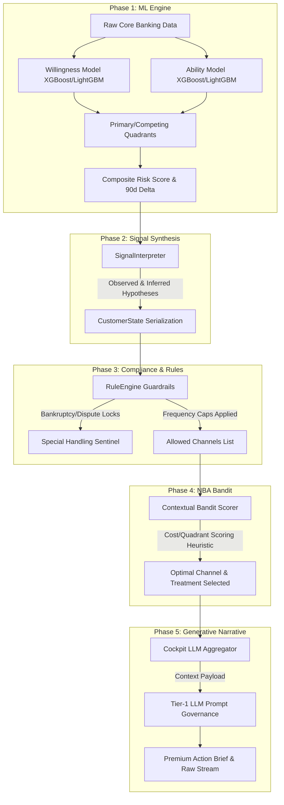

# Collection AI: End-to-End Intelligence Flow & Demo Playbook

This playbook documents the complete end-to-end operational and analytical journey of a delinquent customer account through the **Collection AI** ecosystem. It serves as a guide for live executive demos, explaining how raw banking data translates into optimized collector actions and premium explainability narratives.

---

## 1. Executive Summary: The Core Philosophy
Traditional collections systems treat delinquency as a single, flat metric (Days Past Due). **Collection AI** breaks this paradigm by separating customer analysis into two independent, machine-learning-driven dimensions:
1.  **Willingness (Cooperativeness)**: Predicts the customer's *intent* to pay and resolve their debt.
2.  **Ability (Financial Capacity)**: Predicts the customer's *liquid funds* available to settle obligations.

By intersecting these dimensions, the system places each customer into a distinct strategic risk quadrant:

$$\text{Willingness (0 - 100)} \times \text{Ability (0 - 100)} \longrightarrow \text{Actionable Strategy}$$

---

## 2. The Five Phases of the Collections Intelligence Journey

---

### Phase 1: ML Classification & Matrix Gating (The "What")
*   **Willingness Classifier (`TARGET_WILLINGNESS`)**:
    Evaluates communication recency (`DAYS_SINCE_LAST_RPC`), payment promise reliability (`PTP_RELIABILITY_RATIO`), and recent transaction frequency (`PAYMENT_VELOCITY_30D`). 
*   **Ability Classifier (`TARGET_ABILITY`)**:
    Evaluates cash reserves (`CASH_RUNWAY_DAYS_ESTIMATED`), income stability (`INFLOW_VARIANCE_30D`), debt burden (`DEBT_SERVICE_PROXY_RATIO`), and account empty states (`ZERO_BALANCE_DAYS_RATIO_30D`).
*   **Composite Risk Score & Point Delta**:
    *   **Composite Score (0 - 100)**: The ultimate probability of write-off/unrecoverability. A cooperative customer with no money (Q2) gets a low, safe risk score (e.g., `22/100`) because their high cooperativeness dramatically lowers recovery costs.
    *   **Score Delta (+/- pts)**: Tracks rolling 90-day risk momentum. A `+7 pts (deterioration)` indicates the customer's payment rejections or contact avoidance is actively rising.

---

### Phase 2: Cognitive Signal Synthesis (The "Why")
Before deciding on an action, raw data is passed through the `SignalInterpreter` to form high-level semantic hypotheses:
*   **Observed Signals**: Hard transactional facts (e.g., `[OBSERVED] Payment Rejections` backed by NSF check rates).
*   **Inferred/Hypothesis Signals**: Probabilistic clinical conclusions (e.g., `[HYPOTHESIS] Liquidity Disruption` derived from high income variance, indicating a delayed salary or job loss).
*   *Why this is used*: It translates database floats and integers into cognitive concepts that the LLM and the Bandit can reason about cleanly.

---

### Phase 3: Rule-Based Guardrails & Exclusions (The "Safety")
Legal and operational limits must be 100% deterministic and can never be left to machine learning models:
*   **Exclusion Rules**: If an account is legally locked, bankrupt, or has an active dispute, the `RuleEngine` bypasses all collection actions and flags it as `Special Handling`.
*   **Frequency Rules**: Prevents overwhelming the customer. If the SMS cap (e.g., 2 per week) or Call cap (e.g., 1 per day) is breached, those channels are pruned from the allowed pool.

---

### Phase 4: Contextual Bandit Channel Scoring (The "How")
The allowed channels list is evaluated by the `ContextualBandit` using a cost-to-aggressiveness hierarchy:
*   **The Cost Scale**: `Email (1) -> SMS (2) -> Call (3) -> Letter (4) -> Field Visit (5)`.
*   **Soft vs. Hard Quadrants**: Cooperative customers (Q1, Q2) are steered toward low-cost digital channels. Evasive customers (Q3, Q4) trigger aggressive escalations.
*   **The Reinforcement Learning Roadmap**: The engine includes a `RewardTracker` stub. Once 90 days of baseline outcomes (paid vs. ignored) are logged in the DWH, the bandit shifts from static heuristics to dynamic online exploration using **Thompson Sampling** to select high-recovery actions automatically.

---

### Phase 5: Premium Generative Explainability (The Narrative)
The final step synthesizes the entire analytical pipeline into a professional, multi-paragraph **Agent Action Brief** generated by a local or cloud LLM.
*   **Strict Narrative Governance**:
    *   *No SHAP Likelihood Framing*: SHAP percentages are framed strictly as decision weights driving the classification, never as default probabilities.
    *   *Epistemic Weight Separation*: Observed signals are treated as structural facts; inferred hypotheses are treated as probable inferences.
    *   *KYC Compliant*: Gated rules block restructuring offers if KYC is overdue (`Refresh due`).
*   **Interactive Demo Dashboard**:
    The collections officer accesses the cockpit, enters a customer ID via a glassmorphic search portal, reviews SHAP drivers, is warned of missing triggers by dynamic UI alerts, simulates different payment scenarios on the forbearance sliders, and reviews the premium neural narrative brief.
