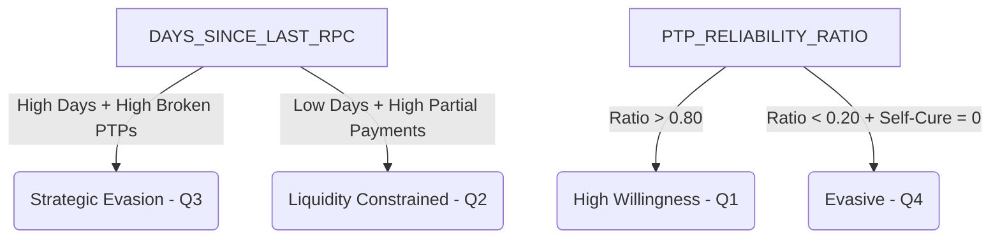

# Collection AI: Willingness Feature Dictionary & Behavioral Mechanics

In an enterprise debt collection paradigm, **Willingness** (Cooperativeness) is modeled separately from **Ability** (Financial Capacity). 

* **Willingness Model**: Predicts the likelihood that a customer *intends* to resolve their arrears and is willing to engage in communication, keep commitments, and self-cure.
* **Ability Model**: Predicts the liquid financial capacity of the customer to fulfill a given obligation.

Separating these dimensions allows the **Matrix Engine** to classify customers into one of four strategic quadrants:
* **Q1 (Low Risk - Cooperative / Has Funds)**: Auto-recovers or resolves with light touch.
* **Q2 (Vulnerable - Cooperative / Lacks Funds)**: Requires restructuring, forbearance, or terms extension.
* **Q3 (Strategic Defaulter - Evasive / Has Funds)**: Requires intensive dunning, penalty threats, or early legal escalation.
* **Q4 (High Risk - Evasive / Lacks Funds)**: Early write-off candidate or immediate asset recovery.

---

## Technical Feature Dictionary & Behavioral Analysis

Below is the detailed breakdown of the features used in the Willingness classifier (`TARGET_WILLINGNESS`), explaining what each feature represents, how it is calculated, and its specific role in modeling consumer behavior.

| Feature Name | Data Type | Concept Category | Predictive Role in Willingness Modeling |
| :--- | :--- | :--- | :--- |
| **`CUST_INFO_ID`** | `pl.String` | Metadata | **Entity Identifier**: Uniquely identifies the customer. Excluded from training features to prevent leakage and overfitting. Used strictly as a key for left joins. |
| **`SNAPSHOT_DATE`** | `pl.String` | Temporal | **Temporal Anchor**: Defines the specific date when the features were calculated. Excluded from training, but critical for out-of-time (OOT) validation splits to verify model stability over time. |
| **`DAYS_SINCE_LAST_RPC`** | `pl.Int64` | Communication | **Right Party Contact (RPC) Decay**: The number of days since the collectors verified contact with the actual debtor. High values are a strong negative driver, indicating high evasion and contact avoidance (Strategic Defaulter / Q3 or Q4). Low values suggest open lines of communication (Cooperative / Q1 or Q2). |
| **`PTP_RELIABILITY_RATIO`** | `pl.Float64` | Commitment | **Promise-to-Pay (PTP) Reliability**: The percentage of historical PTP agreements that were successfully paid in full. This is the **single most predictive signal of behavioral willingness**. High ratios (~1.0) indicate high epistemic willingness. Low ratios (~0.0) indicate strategic evasion (making empty promises to buy time). |
| **`PAYMENT_VELOCITY_30D`** | `pl.Int64` | Transactional | **Recent Payment Frequency**: The number of payments made in the last 30 days. Higher values indicate an active effort to cure delinquency, demonstrating high current willingness even if individual transaction amounts are small. |
| **`PARTIAL_PAYMENT_RATIO`** | `pl.Float64` | Financial-Intent | **Installment Coverage**: The ratio of partial payments made relative to the total due installment. A high partial payment ratio (e.g. paying 30% of the past-due amount regularly) is a **hallmark Q2 Vulnerable signal**—it proves the customer has high willingness to pay but has a severe ability bottleneck. |
| **`SELF_CURE_HISTORY_FLAG`** | `pl.Int64` | Autonomy | **Autonomous Resolution**: A binary flag (1 = has a history of paying off arrears without collection calls; 0 = requires active dunning). A value of 1 shows high autonomous willingness, allowing the system to place them on lower-cost digital self-cure channels. |
| **`BOUNCE_RATE_60D`** | `pl.Float64` | Transactional | **Payment Friction**: The ratio of rejected payments (e.g. checks returned due to NSF, failed direct debits) over the last 60 days. While technically a negative transaction driver, if paired with low contact avoidance (low RPC days), it shows a customer who is trying to pay but facing liquidity issues (Q2). |
| **`BROKEN_PTP_COUNT_6M`** | `pl.Int64` | Commitment | **Chronic Default Volatility**: The absolute count of broken promises over the last 6 months. High counts represent a behavioral trend of empty promises, signifying a pivot from cooperative to evasive behavior (strategic delay tactics). |
| **`TARGET_WILLINGNESS`** | `pl.Int64` | Dependent | **Target Label**: The binary dependent variable (1 = Willing/Cooperative; 0 = Unwilling/Evasive). Behaviorally defined as a customer who either honors their PTP, contacts collections proactively, or agrees to a formal restructuration within the performance window. |

---

## Strategic Interaction Matrix (SHAP Driver Mechanics)

During machine learning training (using XGBoost or LightGBM), features do not act in isolation. The **Matrix Engine** leverages interaction weights to decipher true customer intent:

### Key Behavioral Scenarios Interpreted by the Model

1. **High Willingness / Low Ability (Q2 - The Struggling Debtor)**
   * *Feature Profile*: `DAYS_SINCE_LAST_RPC` is low (< 5 days), `PARTIAL_PAYMENT_RATIO` is high (e.g., 0.35), `BOUNCE_RATE_60D` is high, but `PTP_RELIABILITY_RATIO` is moderate.
   * *Interpretation*: The customer is talking to agents (low RPC days) and paying whatever they can (high partial payments), but transactions are bouncing due to empty pockets. The model classifies this customer as **Willing** (`TARGET_WILLINGNESS = 1`). The recommended channel is **Restructuring / Forbearance** rather than legal escalation.

2. **Low Willingness / High Ability (Q3 - The Strategic Defaulter)**
   * *Feature Profile*: `DAYS_SINCE_LAST_RPC` is extremely high (> 90 days), `BROKEN_PTP_COUNT_6M` is high, `PARTIAL_PAYMENT_RATIO` is 0.0, but credit scores or external salary indicators (from the context mart) are strong.
   * *Interpretation*: The customer has the funds but is actively hiding from the bank (high RPC days) and has paid nothing. The model classifies this customer as **Unwilling** (`TARGET_WILLINGNESS = 0`). The recommended channel escalates immediately to aggressive legal/field visits to force engagement.
