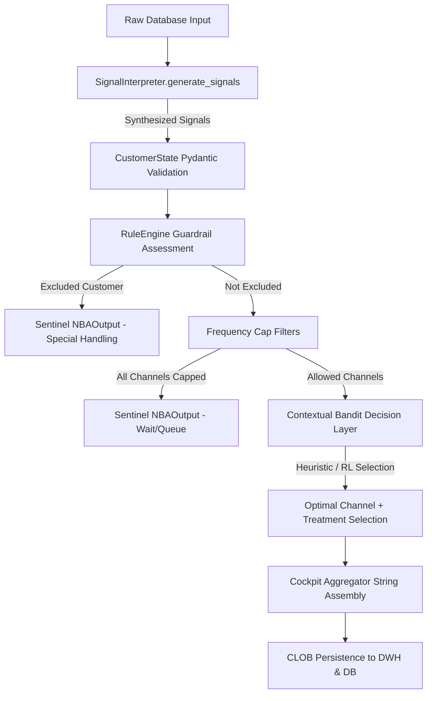

# Collection AI: Next Best Action (NBA) Engine Architecture & Lifecycle

The **Next Best Action (NBA) Engine** is the core operational brain of our collection system. It serves as the decision gateway that translates mathematical risk classifications into highly customized, legally compliant, and cost-effective communication recommendations.

---

## 1. The End-to-End Lifecycle of an NBA Action

When a customer profile enters the NBA pipeline, it traverses a highly modular, insulated, and sequential execution lifecycle:



### Step 1: Cognitive Signal Synthesis (`SignalInterpreter`)

Before any validation occurs, raw, unformatted metrics (e.g., `payment_rejection_freq`, `inflow_variance_30d`, `contact_avoidance_index`) are passed to the `SignalInterpreter`. This component translates abstract numbers into cognitive semantic representations:

* *Observed Signals*: Definitive transactional facts (e.g., `Payment Rejections` backed by 2 NSF events).
* *Inferred/Hypothesis Signals*: Probabilistic inferences (e.g., `Liquidity Disruption` derived from income volatility).

### Step 2: Strong-Type Serialization (`CustomerState`)

The combined dictionary (raw metrics + synthesized signals) is serialized into a Pydantic `CustomerState` model. This acts as a strict typing firewall, catching database schema mismatches, null values, or conversion issues immediately, isolating failures to single rows without crashing batch runs.

### Step 3: Compliance Filtration (`RuleEngine`)

The validated `CustomerState` is evaluated by the `RuleEngine` across two sequential gates:

1. **Exclusions**: Checks for administrative flags (active disputes, legal locks, bankruptcy). If flagged, the customer is routed to `"Special Handling"` with a `None` channel.
2. **Frequency Caps**: Evaluates transaction volume (e.g., has the customer already received 2 SMS this week? 1 call today?). Capped channels are pruned from the allowed space. If no allowed channels remain, the engine issues a `"Wait"` instruction.

### Step 4: Optimal Action Selection (`ContextualBandit`)

The bandit accepts the pre-filtered array of allowed channels.

1. **Treatment Determination**: Mapped directly from the customer's risk quadrant (e.g. Q1 -> Promise to Pay, Q2 -> Term Scheduling/Restructuring, Q4 -> Partial Payment).
2. **Channel Scoring**: The bandit scores each allowed channel (0 to 100) based on costs, quadrant, and signal interactions, selecting the highest-scoring arm.

### Step 5: Packaging & DB Persistence

The final selected action, alternative channels, raw database values, and explainability signals are compiled into an `NBAOutput` record, converted into a highly structured JSON cocktail payload, and stored as an Oracle CLOB for real-time dashboard rendering.

---

## 2. Decision Mechanics: Rules vs. Machine Learning

The NBA engine utilizes a **hybrid architecture** that separates deterministic constraints from probabilistic optimizations.

```
┌────────────────────────────────────────────────────────────────────────┐
│                              NBA ENGINE                                │
├───────────────────────────────────┬────────────────────────────────────┤
│     DETERMINISTIC GUARDRAILS      │       PROBABILISTIC BANDIT         │
├───────────────────────────────────┼────────────────────────────────────┤
│ * Enforces legal compliance       │ * Optimizes cost vs. response      │
│ * Evaluates frequency caps        │ * Scores channel alternatives      │
│ * Excludes disputes/bankruptcy    │ * Driven by ML-generated inputs    │
│                                   │                                    │
│   "Safety Goggles" (Rule Engine)  │     "Decision Optimizer" (Bandit)  │
└───────────────────────────────────┴────────────────────────────────────┘
```

* **The Input Layer**: Is purely **Machine Learning** driven (Willingness & Ability scores generated via LightGBM/XGBoost models).
* **The Guardrail Layer**: Is purely **deterministic & rule-based**. Legal compliance, frequency limits, and exclusion criteria can *never* be left to probabilistic ML models due to regulatory and compliance liability.
* **The Action Selector**: Currently uses a **Heuristic Expert System Policy** that maps behavioral signals and cost hierarchies to optimize channel assignment.

---

## 3. Why Reinforcement Learning (RL) Has Not Been Activated (Yet)

Reinforcement learning (RL) via **Contextual Bandits** (e.g., LinUCB, Thompson Sampling) is the ultimate Tier-1 end-state, but it is currently locked in a **Scaffolding/Stub phase (`RewardTracker`)** due to three core production bottlenecks:

1. **The Cold-Start Safety Hazard**:
   An RL agent must initially explore its environment by randomly selecting arms. In collections, random exploration has severe consequences: sending a field agent to a highly cooperative VIP customer ($Q1$) damages relationship value, while sending a polite automated email to an evasive strategic defaulter ($Q4$) guarantees financial write-off. We must run a safe, expert-derived baseline policy first.
2. **High Feedback Latency (The Outcome Gap)**:
   Unlike ad-clicks (which provide rewards in milliseconds), a collections action's reward (i.e. did they pay? did they promise?) takes **30 to 90 days** to materialize. Online RL models cannot train instantly; they require a "burn-in" period of collected actions and realized outcomes before updating policies safely.
3. **The RL Scaffolding Scaffolder**:
   `bandit.py` is pre-engineered to support RL. The `RewardTracker` acts as a data collector that accumulates (customer profile, selected channel, outcome label) tables in the background. Once 90 days of operational logs are established, the engine will activate true online learning without requiring any structural changes.

### When RL is Activated: What Changes?

When the `RewardTracker` is switched from heuristic stub to online learning:

* **Dynamic Arm Scoring**: Instead of hardcoded scores (e.g. `base_score += 20` for outgoing calls), the bandit will query `RewardTracker.get_arm_weights(quadrant, context_vector)`.
* **Thompson Sampling**: The engine will model expected repayment probability as a Beta distribution ($\alpha, \beta$ updates). For instance, if an SMS yields a recovery 40 out of 100 times, and an email yields 10 out of 100 times, the agent will dynamically balance exploring emails vs. exploiting the higher-yield SMS arm.
* **Granular Context Matching**: The bandit will learn that even within quadrant Q2, customers under 30 respond highly to digital channels, whereas customers over 55 require telephone RPCs, shifting policies dynamically based on subtle personal data combinations.

---

## 4. Analysis of the `generate_signals` Function

The `generate_signals` method inside `SignalInterpreter.py` is a **Cognitive Semantic Bridge**.

### What is it and why is it used?

It translates numeric, non-intuitive database fields into high-level, human-readable hypotheses.

1. **Semantic Gating for the LLM**: An LLM cannot reason about numbers like `INFLOW_VARIANCE_30D: 785.4` or `CONTACT_AVOIDANCE_INDEX: 0.72`. It can, however, write exceptionally dense, expert-level briefs when given semantic structures like `[HYPOTHESIS] Liquidity Disruption` or `[INFERRED] Evasive Pattern`.
2. **Interaction Shortcut for the Bandit**: It abstracts raw metrics into combined scenarios (e.g. `has_evasion`, `has_liquidity_crisis`), preventing the bandit from needing messy, nested, multi-variable logic.

### Why is it hardcoded?

It is currently hardcoded because it encodes **expert institutional rules**. In banking collections, transaction and communication triggers must match strict operational and regulatory guidelines (e.g., NSF check rejections are legal triggers).

### Making it Dynamic in Production

Hardcoding rules is clean for a demo, but in an enterprise production environment, we want to transition to a **Dynamic Signals Engine** through two primary paths:

#### 1. The Signal Registry Configuration Pattern

Instead of hardcoding Python `if` statements, you store trigger logic in a database or a configuration schema (YAML/JSON):

```json
{
  "signal_id": "SIG_LIQUIDITY_DISRUPT",
  "title": "Liquidity Disruption",
  "type": "HYPOTHESIS",
  "condition": "payment_rejection_freq > 0 and inflow_variance_30d > 500.0",
  "confidence_expression": "max(0.55, min(0.75, 1.0 - ability_score))"
}
```

In production, a **Rule Parser** (such as Python's `asteval` or a standard rules compiler) reads this registry daily, compiles the conditions dynamically, and evaluates the customer DataFrame. This allows business analysts to change signal thresholds or add new cognitive signals *without writing a single line of code*.

#### 2. Unsupervised ML Anomaly Injection

Instead of using manual thresholds (like `inflow_variance > 500.0`), you train an **unsupervised anomaly detection model** (e.g., Isolation Forest or reconstruction autoencoder) on historical transactional patterns.
If a customer's monthly balance profile fluctuates abnormally, the model dynamically issues an `[INFERRED] Transactional Anomaly` signal with a calculated reconstruction error confidence score. The system becomes completely autonomous and adaptive, finding payment disruptions that human rules could never anticipate.
